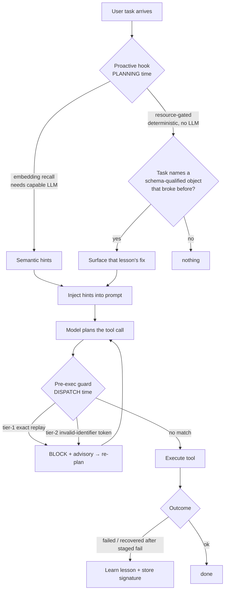

# Failure-Recovery: Deterministic Prevention Design

Durable problem→solution lessons learned when an agent recovers from a tool
failure, applied so the same mistake does not recur in later sessions. This
document describes the **deterministic prevention layer** added on top of the
original embedding-based recall: a pre-execution guard that matches the agent's
*planned* tool call, and a resource-gated advisory that surfaces a lesson at
*planning* time — both working without any LLM in the detection path.

**Target Audience**: Architects and advanced developers

**Version**: v1.4.0

**Status**: ✅ Implemented (validated end-to-end against a live Teradata backend)


## Table of Contents

- [Motivation](#motivation)
- [Design Goals](#design-goals)
- [The Core Pivot: Match the Planned Call, Not the Intent](#the-core-pivot-match-the-planned-call-not-the-intent)
- [Architecture Overview](#architecture-overview)
- [The Three Detection Tiers](#the-three-detection-tiers)
  - [Tier 1 — Exact Replay (dispatch)](#tier-1--exact-replay-dispatch)
  - [Tier 2 — Invalid-Identifier Token (dispatch)](#tier-2--invalid-identifier-token-dispatch)
  - [Resource-Gated Advisory (planning)](#resource-gated-advisory-planning)
- [The Signature](#the-signature)
- [Learn-Time Flow](#learn-time-flow)
- [Read-Time Flows](#read-time-flows)
- [Soundness Argument](#soundness-argument)
- [PII and Scoping](#pii-and-scoping)
- [Observability](#observability)
- [Configuration](#configuration)
- [Worked Example: The Live Demo](#worked-example-the-live-demo)
- [Design Trade-offs](#design-trade-offs)
- [Constraints and Limitations](#constraints-and-limitations)
- [Testing](#testing)
- [File Map](#file-map)


## Motivation

The original failure-recovery feature stored an abstract `(problem, solution)`
lesson on recovery and read it two ways:

- **Reactive** — on a *new* tool failure, embed the error and recall the nearest
  lesson at a strict cosine gate. Precise, but only fires *after* a failure.
- **Proactive** — at the start of a user query, embed the task intent and recall
  the nearest lessons above a low floor. Fires before a failure, but depends on
  an embedding match between **task-space** (what the user asked) and
  **failure-space** (how a past call broke).

The proactive path has a structural weakness: a user's raw intent and a stored
failure are written in different vocabularies. Closing that gap requires an LLM
to translate the intent into failure-space (`Proactive.LLMIntent`). Empirically,
with `llm_intent: false` the proactive recall returned **zero** matches on the
exact cases it was meant to prevent — proactive prevention silently depended on a
capable LLM being available.

The deterministic prevention layer removes that dependency for the cases where a
sound, LLM-free signal exists.


## Design Goals

1. **Prevention without an LLM in the detection path.** Detection must work when
   the model is weak, slow, or disabled. Correction stays the model's job.
2. **Match ground truth, not a paraphrase.** Compare concrete artifacts (planned
   `tool+args`, schema-qualified object names) rather than two embeddings of
   natural language.
3. **Soundness over coverage.** Never block a call that could legitimately
   succeed. A false positive that blocks a valid call — or the fix itself — is
   worse than a miss.
4. **Bounded retrieval.** Surface the lesson for *the object in hand*, never a
   dump of all memory.
5. **No overfitting.** Signals are derived from the engine's own error text and
   the call's own identifiers — nothing is hand-tuned to a specific demo case.

**Non-goals**:

- Parsing SQL (or any tool's) grammar to detect misuse semantically.
- Replacing the embedding-based reactive/proactive paths — this layer *augments*
  them.
- Guaranteeing a learned mistake *can never* recur: a novel re-derivation still
  depends on the model applying a surfaced advisory.


## The Core Pivot: Match the Planned Call, Not the Intent

The original proactive path predicts a failure from the **user's intent**
(`U → G`, task-space, LLM-dependent). The deterministic layer instead intercepts
the agent's **planned tool call** at the dispatch seam (`G → X`) — the same space
as the stored failure (`tool + args + error`):

```
User ──U──> Agent/Gateway ──G──> [PLAN: tool + args] ──X──> Tool
            (task-space)          (ground truth, failure-space)
```

Matching a concrete planned call against a concrete past failure is a
deterministic string comparison. Matching two natural-language paraphrases is
not. That is the entire basis of the design.


## Architecture Overview



Two moments act:

- **Planning time** (before the model commits to a call): the resource-gated
  advisory surfaces a lesson's fix when the task references a known-bad object.
- **Dispatch time** (after the model plans, before the tool runs): the pre-exec
  guard blocks a provably-wrong call (exact replay or invalid-identifier reuse).


## The Three Detection Tiers

| Tier | When | Mechanism | Catches | LLM? |
|------|------|-----------|---------|------|
| **Resource-gated advisory** | Planning | Task text names a schema-qualified object whose failing call is stored → surface its fix | A *semantic re-derivation* — a different call that repeats the same defect on the **same object** | No |
| **Tier 1 — exact replay** | Dispatch | Planned `tool+args` is byte-identical to a past failed call | The agent re-issuing the **identical** bad call | No |
| **Tier 2 — invalid-identifier token** | Dispatch | An identifier the engine declared **unknown/nonexistent** reappears in planned args | Reusing a bogus tool name / missing object | No |
| **Cross-object advice** | Dispatch | Planned call's structural **skeleton** (object identifiers removed) matches a stored failing call's skeleton | The **same call shape on a *different* object** — the cross-table case the others miss | No |

### Tier 1 — Exact Replay (dispatch)

The planned call is serialized with `canonicalCall(tool, args)` — a stable,
order-independent, lowercased form `tool(k=v,...)` with sorted keys — and
compared for equality against each stored signature's `CanonicalCall`. An exact
match means the agent is about to repeat a call that is *known* to fail. This is
the strongest, most certain tier.

### Tier 2 — Invalid-Identifier Token (dispatch)

Some failures name an identifier the engine declared **invalid** — `unknown tool
'execute_sql_query'`, `no such table`, `X does not exist`, `not recognized`,
`undefined`, `invalid object`. `extractOffendingTokens` harvests **only** those
identifiers (see [Soundness Argument](#soundness-argument) for why only
invalidity errors qualify). If any such token reappears in the planned call's
arguments (`argTokens`, a recursive scan of arg values, keys, and the tool name),
the call is about to repeat the mistake.

Tier 2 deliberately does **not** require a matching tool name: the gateway
pattern (`teradata_tool_call` wrapping a bogus inner `execute_sql_query`) means
the offending token travels in the *arguments* of a differently-named outer tool.

### Resource-Gated Advisory (planning)

Tiers 1 and 2 run at dispatch — too late for a *re-derived* call. The advisory
closes that gap at planning time. At learn time the signature records
`ResourceTokens`: the **schema-qualified** objects the failing call touched
(e.g. `agentic_demo.demo_fr_orders` and its tail `demo_fr_orders`). At planning
time, `resourceTokensFromText` extracts the dotted identifiers from the task
text; a lesson is surfaced **only if** one of its resource tokens appears in the
task (`matchResource`). The lesson's fix is injected as an advisory before the
model plans.

This is bounded by construction:

- Only **schema-qualified** names gate — a bare word (e.g. `order`) can never
  pull a lesson in.
- A task naming a *different* object gets nothing.
- An object with no prior failure gets nothing.

It is retrieval keyed on the object in hand — not "inject all memory."

### Cross-Object Advice (dispatch)

The resource-gated advisory is **object-bound**: it fires only when the task
names the *same* schema-qualified object a lesson failed on. It therefore does
nothing when the model plans the **same kind of call on a *different* object** —
e.g. the unquoted-reserved-word mistake repeated on another table. `PreExecAdvice`
closes that gap.

It reduces the planned call to a **structural skeleton** — the tool name, the
argument keys, and the identifier/keyword tokens of the argument values, with the
concrete **object identifiers removed** (`callSkeleton`). The stored side is
derived the same way from each signature's `CanonicalCall`
(`skeletonFromCanonical`), dropping that signature's own `ResourceTokens`.
Two calls that differ *only* in which object they touch collapse to the **same
skeleton**, so their Jaccard similarity (`skeletonSimilarity`) is `1.0`; an
unrelated call shares little and scores near `0`.

When the similarity clears `adviceSkeletonThreshold` (0.7) and the intersection
clears `adviceMinSkeletonOverlap` (3 shared tokens, so a couple of wrapper tokens
alone cannot trip it), the lesson's *problem + fix* is surfaced as an advisory.
Exact replays are **skipped** here — that is Tier 1's certain-block job.

Unlike a vector approach, this does not depend on embeddings. A vector query
keyed on the raw planned call could not work: the lesson's embedding is computed
on the **abstracted problem** (error-vocabulary, e.g. *"malformed query or
expression syntax"*), while a planned call is in **call-vocabulary** (`select
order from …`). The two live in different vocabularies, so a raw-call vector query
would rarely align with problem-space lessons. The skeleton match sidesteps this
by comparing call-shape to call-shape, deterministically.

Because a structural match is a **strong signal but not a certainty**, this tier
is **advisory, not a block**: it surfaces the lesson and lets the planning model
decide. To keep a non-certain match from trapping a loop, it fires **at most once
per distinct planned call per session** (`tracker.markAdvisedIfNew`).


## The Signature

Captured at failure time, compared at read time. Stored in a lesson's
`properties_json.signature` **only when user-scoped** (see [PII and
Scoping](#pii-and-scoping)).

```go
type callSignature struct {
    // Tool is the tool name of the failing call.
    Tool string `json:"tool,omitempty"`

    // CanonicalCall is a stable, order-independent serialization of
    // tool+arguments used for tier-1 exact-replay matching.
    CanonicalCall string `json:"canonical_call,omitempty"`

    // OffendingTokens are identifiers the ERROR declared INVALID (unknown /
    // nonexistent). Their reuse in a planned call is a sound tier-2 signal.
    OffendingTokens []string `json:"offending_tokens,omitempty"`

    // ResourceTokens are the schema-qualified objects the FAILING call touched.
    // They are the retrieval key for the planning-time advisory tier.
    ResourceTokens []string `json:"resource_tokens,omitempty"`
}
```

| Field | Produced by | Consumed by |
|-------|-------------|-------------|
| `CanonicalCall` | `canonicalCall(tool, args)` | Tier 1, Cross-object advice (skeleton) |
| `OffendingTokens` | `extractOffendingTokens(errMsg)` | Tier 2 |
| `ResourceTokens` | `resourceTokensFromArgs(args)` | Resource advisory, skeleton object-drop |


## Learn-Time Flow

A lesson (and its signature) is written **once, on recovery** — i.e. when a tool
succeeds *after* a staged failure in the same session.

```mermaid
sequenceDiagram
    participant A as Agent
    participant E as FR Engine
    participant S as Graph Store

    A->>E: OnToolFailure(session, class, tool, errMsg, FailedCall{tool,args})
    Note over E: build callSignature<br/>CanonicalCall = canonicalCall(tool,args)<br/>OffendingTokens = extractOffendingTokens(errMsg)<br/>ResourceTokens = resourceTokensFromArgs(args)
    E->>E: tracker.recordFailure(rec with sig)
    A->>E: OnToolSuccess(ctx, agentID, session, tool)
    Note over E: write-once lesson; if UserScoped && !sig.empty()<br/>persist properties.signature = sig.marshal()
    E->>S: Remember(lesson + signature)
```

The offending tokens always come from the engine's own error text — never
hand-picked — which keeps tier-2 data-driven rather than tuned.


## Read-Time Flows

### Planning time — `ProactiveHints`

```
intent ──▶ (optional LLMIntent translation) ──▶ embedding recallTopK ──▶ semantic hints
       └─▶ resourceGatedHints(ctx, agentID, intent) ──▶ deterministic hints
                                                         └─ merged + deduped, capped at MaxHints
```

`resourceGatedHints` runs regardless of the embedding path and regardless of
`LLMIntent`, so a lesson is surfaced deterministically whenever the task names a
known-bad object. `mergeHints` de-duplicates so a lesson surfaced by both paths
appears once.

### Dispatch time — `PreExecGuard`

```
planned (tool,args) ──▶ canonicalCall + argTokens
                        ──▶ for each candidate signature: matchTier(sig, canonical, tokens)
                        ──▶ tier 1 (exact) or tier 2 (token) ⇒ GuardHint
                        ──▶ strongest-tier-first, capped at MaxHints
```

On a match the agent injects the advisory, synthesizes a **blocked** tool result
(code `failure_recovery_guard`), and returns **without executing** the call — the
known-bad call never runs. The model then re-plans with the advisory in context.

### Dispatch time — `PreExecAdvice`

Run **after** `PreExecGuard` returns no certain match, as a cross-object fallback:

```
planned (tool,args) ──▶ callSkeleton (object identifiers removed)
                        ──▶ for each candidate signature (skip exact replay):
                            skeletonSimilarity(planned, skeletonFromCanonical(sig))
                        ──▶ jaccard ≥ 0.7 AND overlap ≥ 3 ⇒ advisory (problem + fix)
                        ──▶ markAdvisedIfNew(canonical): surface once per call, then proceed
```

Unlike the guard, this does **not** block the call: it injects an advisory
(`[Failure-Recovery Advice]`) so the model can revise the call if the pitfall
applies, and otherwise proceed. It is user-scoped only (it reads stored
signatures).


## Soundness Argument

The central rule: **only an identifier the engine declared INVALID is eligible
for deterministic token-blocking (tier 2).**

> An identifier the engine calls *unknown* or *nonexistent* can never
> legitimately appear in a valid call. So if a planned call contains it again,
> that reuse is certainly a repeat of the same mistake — blocking it cannot cause
> a false positive.

The contrapositive explains why **reserved-word / syntax errors yield zero
tier-2 tokens**:

> A reserved word like `order` is a *valid* identifier that was merely *misused*
> (unquoted). It legitimately reappears — in the quoted fix (`"order"`), in an
> unrelated `ORDER BY` clause, and in other valid queries. Token-blocking it
> would false-positive on correct calls and could even block the very correction
> the agent needs, causing a loop.

Reserved-word repeats are therefore handled by:

- **Tier 1** when the agent re-issues the *identical* failing call, and
- the **resource-gated advisory** when the agent plans a *different* query on the
  *same object* — surfacing "quote reserved identifiers on this table" at
  planning time, and letting the model apply it.

This division — **deterministic detection, model-driven correction** — is what
keeps the system sound without hard-coding any specific fix.


## PII and Scoping

Signatures carry concrete identifiers (real tool names, queries, schema-qualified
objects). They are therefore stored and matched **only when `user_scoped: true`**
— the same rule the LLM abstractor's `PreserveDetails` already follows:
identifiers are the author's own schema, safe to store and show back only to that
author, but preserving them in shared memory would leak one user's schema to
another.

In shared (non-user-scoped) mode the deterministic layer is **fully inert**
(fail-closed): `buildLesson` never persists a signature, `PreExecGuard` returns
`nil`, and `resourceGatedHints` returns `nil`. Only the original abstract
embedding paths run.


## Observability

| Event | Where | Meaning |
|-------|-------|---------|
| `guard.match` (debug log) | `PreExecGuard` | A planned call matched a signature; fields: `agent_id`, `tool`, `matches`, `top_tier` |
| `failure_recovery.guard_hit` (span event) | `PreExecGuard` | Same match, for tracing |
| `failure_recovery.guard_blocked` (span event) | agent `guardPlannedCall` | The call was blocked and an advisory injected |
| `proactive.resource` (debug log) | `resourceGatedHints` | The advisory fired; fields: `agent_id`, `matches` |
| `preexec.advice` (debug log) | `PreExecAdvice` | A cross-object skeleton match surfaced advice; fields: `agent_id`, `tool`, `matches` |
| `failure_recovery.preexec_advice` (span event) | `PreExecAdvice` | Same cross-object match, for tracing |
| `failure_recovery.advice_injected` (span event) | agent `guardPlannedCall` | A cross-object advisory was injected (not a block) |

`top_tier` lets a prevented repeat be attributed to a real guard hit versus mere
model competence — honest attribution rather than assuming the mechanism worked.


## Configuration

The deterministic layer requires **no new config fields**. It activates from the
existing settings:

```yaml
failure_recovery:
  enabled: true
  user_scoped: true        # REQUIRED for the deterministic layer (PII rule)
  preserve_details: true
  similarity_threshold: 0.75
  proactive:
    enabled: true          # REQUIRED for the planning-time advisory
    # No threshold: proactive always fetches the 3 nearest lessons (advisory;
    # the injected directive filters by planned action)
    llm_intent: false      # the advisory works regardless of this
  llm_abstraction:
    enabled: true
```

- `user_scoped: true` arms signatures and both dispatch tiers.
- `proactive.enabled: true` arms the planning-time resource-gated advisory.
- `llm_intent` is orthogonal: the advisory is deterministic and does not need it.
- `semantic_only: true` (optional) disables the entire deterministic layer —
  the resource-gated advisory, the pre-exec guard, and the cross-object
  skeleton advice — leaving only semantic retrieval (embedding recall with
  FTS5 fallback) on both the reactive and proactive paths. Signatures are
  still stored while it is on, so disabling it later re-arms deterministic
  matching against everything learned meanwhile.

Internal constant: `maxGuardCandidates = 50` bounds how many stored lessons the
guard scans per planned call (the set is per-agent and small; the cap only
protects against a pathological history).

Cross-object advice constants: `adviceSkeletonThreshold = 0.7` (minimum skeleton
Jaccard) and `adviceMinSkeletonOverlap = 3` (minimum shared skeleton tokens).
These gate the dispatch-time `PreExecAdvice` fallback; it is armed by the same
`user_scoped: true` flag as the rest of the deterministic layer.


## Worked Example: A Live Demo Run

A local demo run (a Teradata backend, not shipped in this repository) exercised two learned
mistakes across paired sessions, with `llm_intent: false`:

| Session | What it does | Outcome |
|---------|--------------|---------|
| S1 (reserved kw, 1st) | `SELECT order FROM agentic_demo.demo_fr_orders` | Fails on reserved `order`, recovers (quotes it), **learns** — signature stores `resource_tokens: [agentic_demo.demo_fr_orders, demo_fr_orders]` |
| S2 (reserved kw, learned) | Different query on the **same table** | Task names the table → **`proactive.resource` advisory fires at planning** → agent quotes `order` up front → **no recur** |
| S1b (wrong tool, 1st) | Gateway call with inner `execute_sql_query` | Fails (`unknown tool`), discovers the real tool, recovers, **learns** — `offending_tokens: [execute_sql_query]` + resource tokens |
| S2b (wrong tool, learned) | Same gateway call | **Tier-1 exact replay** blocks at dispatch → agent re-plans → **no recur** |

Observed signatures after a clean run:

```
reserved-kw lesson → resource_tokens: ["agentic_demo.demo_fr_orders","demo_fr_orders"]
                     (no offending_tokens — correct: reserved words are not token-blocked)
wrong-tool  lesson → offending_tokens: ["execute_sql_query"] + resource_tokens: [...]
```

The earlier broken iteration produced 11 noisy tier-2 matches (garbage tokens
like `sql`, `name`) that blocked the agent's own recovery tools; the sound
extractor reduced this to clean, single-digit matches on real signals.


## Design Trade-offs

- **Deterministic detection vs. semantic coverage.** The guard catches only what
  it can prove is wrong (exact replay, invalid-identifier reuse). A *novel*
  query with the same semantic defect is handled by the advisory, which depends
  on the model applying it — a deliberate boundary, not a gap to be closed by an
  unsound grammar heuristic.
- **Resource-gated advisory vs. embedding recall.** The advisory needs an exact
  schema-qualified overlap, so it has perfect precision but only fires when the
  task names the object. Embedding recall has broader reach but needs a capable
  LLM for intent translation. The two are complementary and merged.
- **Cross-object advice vs. certain blocking.** The skeleton match generalizes
  across objects (its whole point), but a strong structural resemblance is not a
  certainty, so it only *advises* (once per call) rather than blocking. It can
  mildly over-fire — e.g. surfacing a "quote reserved words" lesson on a
  `SELECT … FROM` call that already quotes them — which is harmless because it is
  advisory, deduped per call, and user-scoped.
- **No new config.** Reusing `user_scoped` and `proactive.enabled` keeps the
  surface small, at the cost of coupling the deterministic layer's activation to
  those flags.


## Constraints and Limitations

- **Requires `user_scoped: true`.** In shared mode the entire deterministic layer
  is inert by design (PII fail-closed).
- **Advisory requires the object to be named.** If a task references a known-bad
  table only obliquely (no schema-qualified mention), the advisory does not fire.
- **Cross-object advice needs a shared call shape.** `PreExecAdvice` generalizes
  across objects but still requires the planned call to resemble a stored failing
  call's *skeleton*. A genuinely different phrasing of the same defect is left to
  the (post-failure) reactive path, which is problem-space and already
  cross-object.
- **Correction is the model's job.** A surfaced advisory that the model ignores
  will still recur; this is reported honestly via `proactive.resource` + the
  proof table rather than masked by a hard block.
- **Schema-qualified heuristic.** Resource detection keys on dotted identifiers.
  Backends that address objects without a dotted form would need an extended
  resource extractor.


## Testing

Deterministic unit tests (no LLM, no live backend) pin the contract:

- `TestExtractOffendingTokens` — invalid-identifier capture incl. JSON-wrapped
  errors.
- `TestExtractOffendingTokens_ReservedYieldsNone` — reserved/syntax errors yield
  **zero** tokens (soundness).
- `TestCanonicalCall_OrderIndependent` — stable serialization.
- `TestMatchTier_ExactReplay / _TokenOverlap / _NoMatch` — tier selection.
- `TestPreExecGuard_BlocksWrongToolReplay` — tier-2 end-to-end.
- `TestPreExecGuard_ReservedKeyword_ExactReplayTier1` — tier-1 for reserved-word
  replay.
- `TestPreExecGuard_ReservedKeyword_SimilarNotBlocked` — a *different* query
  containing the keyword (incl. the quoted fix and `ORDER BY`) is **not** blocked.
- `TestPreExecGuard_NoFalsePositive` — a clean call with the correct tool passes.
- `TestPreExecGuard_DisabledWhenNotUserScoped` — inert in shared mode.
- `TestResourceGatedAdvisory_SurfacesLessonForSameTable` — the advisory fires for
  the same table on a different query.
- `TestResourceGatedAdvisory_BoundedToReferencedTable` — a different table gets
  nothing.
- `TestResourceGatedAdvisory_BareWordDoesNotGate` — bare words never gate.
- `TestResourceTokensFromArgs_DottedOnly` — only schema-qualified names (and
  their tail) become resource tokens.
- `TestCallSkeleton_DropsObjectKeepsShape` — the skeleton keeps structural tokens
  and drops object identifiers; same shape on different tables scores `1.0`.
- `TestSkeletonSimilarity_UnrelatedScoresLow` — unrelated calls stay below the
  advisory floor.
- `TestPreExecAdvice_SurfacesCrossObject` — a lesson learned on table A is
  surfaced for the same call shape on table B.
- `TestPreExecAdvice_DedupNoLoop` — the same call is advised at most once.
- `TestPreExecAdvice_SkipsExactReplay` — exact replay defers to the guard.
- `TestPreExecAdvice_UnrelatedCallNoAdvice` / `_InertWhenNotUserScoped` —
  specificity and PII fail-closed.

Run with: `go test -tags fts5 ./pkg/failurerecovery/...`


## File Map

| File | Responsibility |
|------|----------------|
| `pkg/failurerecovery/signature.go` | `callSignature`, `canonicalCall`, `extractOffendingTokens`, `argTokens`, `resourceTokensFromArgs/Text`, `matchTier`, `matchResource`, `callSkeleton`, `skeletonFromCanonical`, `skeletonSimilarity` |
| `pkg/failurerecovery/engine.go` | `OnToolFailure` (variadic `FailedCall`), `buildLesson` (signature persist, user-scoped), `PreExecGuard`, `PreExecAdvice` (cross-object), `ProactiveHints` (+ `resourceGatedHints`, `mergeHints`), `signatureCandidates`, `signatureOf`, `formatGuardHint` |
| `pkg/failurerecovery/tracker.go` | `failureRecord.sig`; `advised` set + `markAdvisedIfNew` (advise-once) |
| `pkg/failurerecovery/config.go` | `maxGuardCandidates`, `adviceSkeletonThreshold`, `adviceMinSkeletonOverlap`, and existing config |
| `pkg/agent/agent.go` | `dispatchOneCall` guard seam (passes `session.ID`); `commitToolRow` passes `FailedCall{tool,args}` |
| `pkg/agent/failure_recovery.go` | `guardPlannedCall` (guard block + cross-object advice rendering) + span events |
| `pkg/failurerecovery/signature_test.go` | deterministic unit tests |


## Related Work

- [Graph Memory Architecture](graph-memory.md) — the underlying durable store.
- [Memory Systems](memory-systems.md) — how failure-recovery relates to other
  memory tiers.
- `docs/plans/failure-recovery-memory-spec.md` — the original feature spec
  (reactive + proactive embedding paths).
