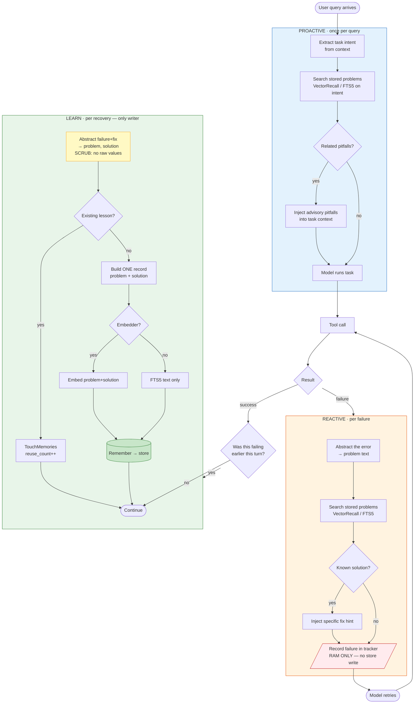
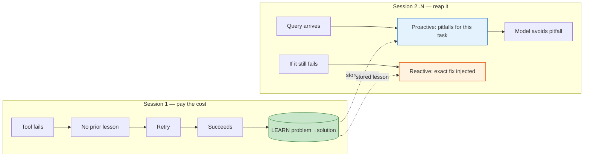
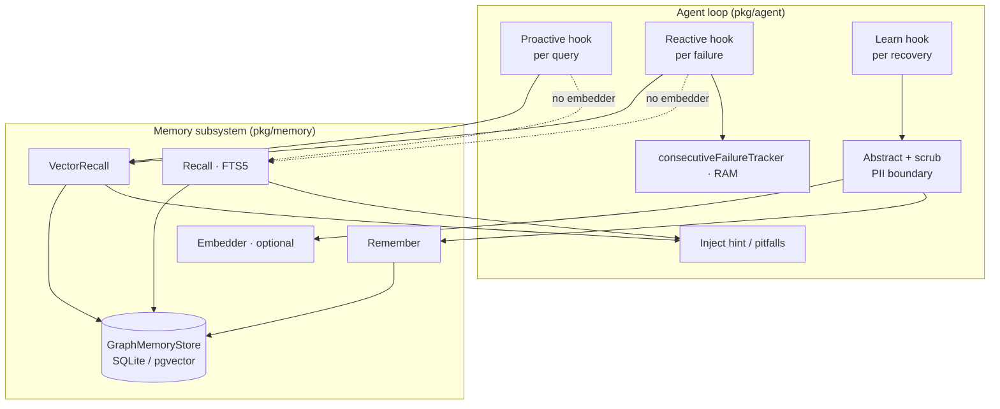

# Failure-Recovery Memory — Specification

**Status**: 📋 Proposed (nothing in this document is implemented yet)

**Baseline**: `main` (v1.4.0)

**Related**: [pkg/memory/store.go](../../pkg/memory/store.go), [pkg/agent/agent.go](../../pkg/agent/agent.go), [pkg/agent/conversation_helpers.go](../../pkg/agent/conversation_helpers.go), [pkg/fabric/guardrails.go](../../pkg/fabric/guardrails.go), [pkg/storage/sqlite/graph_memory_store.go](../../pkg/storage/sqlite/graph_memory_store.go)

**Scope**: A durable memory of **abstract `problem → solution` lessons** learned when the agent recovers from a failure, so it stops re-solving the same failures across sessions. Read two ways: **reactively** on a tool failure (keyed on the error) and **proactively** at the start of a user query (keyed on task intent). First covered set: tool execution errors, malformed tool arguments, and guardrail/validation failures.

This is the *what* (contracts, semantics, surfaces). Every claim about existing code was verified against the baseline.

---

## Contents

- [Executive summary](#executive-summary)
- [A concrete example](#a-concrete-example)
- [Business value & ROI](#business-value--roi)
1. [Motivation](#1-motivation)
2. [What already exists (verified)](#2-what-already-exists-verified)
3. [What is missing](#3-what-is-missing)
4. [Design overview — one store, three hooks](#4-design-overview--one-store-three-hooks)
5. [Architecture](#5-architecture)
6. [Data model — store the lesson, not the incident](#6-data-model--store-the-lesson-not-the-incident)
7. [Write path — learn once on recovery](#7-write-path--learn-once-on-recovery)
8. [Reactive read — recall on failure](#8-reactive-read--recall-on-failure)
9. [Proactive read — pitfalls at query time](#9-proactive-read--pitfalls-at-query-time)
10. [PII & data safety (verified constraint)](#10-pii--data-safety-verified-constraint)
11. [Failure classes](#11-failure-classes)
12. [Configuration](#12-configuration)
13. [Embedding & FTS5 fallback](#13-embedding--fts5-fallback)
14. [Observability contract](#14-observability-contract)
15. [Safeguards](#15-safeguards)
16. [Metrics & success criteria](#16-metrics--success-criteria)
17. [Testing plan](#17-testing-plan)
18. [Staged production rollout](#18-staged-production-rollout)
19. [Compatibility](#19-compatibility)
20. [Rejected alternatives](#20-rejected-alternatives)
21. [Open questions](#21-open-questions)

---

## Executive summary

**Problem.** The agent already recovers from failures *within a single turn*, but **forgets every recovery the moment the turn ends**. The same tool error, malformed argument, or guardrail trip recurs across sessions and is re-solved from scratch every time — burning tokens, latency, and (on paid providers like Bedrock) money.

**Proposal.** A durable **failure-recovery memory** that stores an **abstract `problem → solution` lesson** whenever a failure is recovered from. It is read two ways:

- **Reactively** — when a tool fails, the abstracted error is matched against stored problems and the known solution is injected as a fix hint.
- **Proactively** — at the *start of a user query*, the task intent is matched against stored problems and relevant pitfalls are injected up front as advisory guidance.

**The key simplification.** We store the **lesson, not the incident** — a short, PII-free `problem`/`solution` pair, never raw queries, arguments, or error strings. This one decision does three things at once: it makes the memory **safe** (no sensitive data persisted), **reusable** (an abstract lesson matches many future cases), and **simple** (a single vector/FTS index serves both read paths).

**Granularity that keeps it cheap.** Proactive fires **once per user query** (keyed on intent), not per tool call. Reactive fires **only on a failure**. Neither adds cost to the common success path.

**Fit with current stack.** Reuses the existing `pkg/memory` store (`Remember`, `Recall`, `VectorRecall`) and the in-turn `consecutiveFailureTracker`. Ships **FTS5-first**, which matters because the current Bedrock setup has **no embedder** yet. One append-only config field; no proto churn.

**Ask.** Approve a flagged **Stage-1 spike** — reactive recall + learn for tool-execution errors, FTS5-only, on 1–2 pilot agents — gated on a measured drop in repeat-failure rate and tokens-per-task before wider rollout.

---

## A concrete example

*One pattern, two sessions — the mechanism made tangible (illustrative, not a benchmark).*

**Session 1 — pay once.** The agent runs `run_sql` with a query that uses a reserved SQL keyword as an unquoted identifier. The database rejects it. The model reads the error, retries with the identifier quoted, and succeeds. On recovery, one abstract lesson is stored — `problem:` *"reserved SQL keyword used as an unquoted identifier"* → `solution:` *"wrap the identifier in double quotes"* — with **no query text, arguments, or error string** persisted.

**Session 2..N — reuse for free.**
- **Reactive:** the same class of error surfaces on a different query. Before the model burns a rediscovery loop, the stored fix is injected — *"quote the identifier"* — and the retry succeeds on the first try.
- **Proactive (later stage):** a new query whose intent is "write SQL against this table" arrives. Up front, the agent is pre-warned about the reserved-word pitfall, so the model often avoids it before any tool call fails.

**Key consideration for leadership:** the lesson is abstract, so it matches *every* future occurrence — not just the literal query that first triggered it — and it carries **no sensitive data**. The cost is paid once; every later occurrence is shorter, cheaper, and quieter. This same shape applies to malformed tool arguments and guardrail trips.

---

## Business value & ROI

| Lever | Today | With failure-recovery memory |
|---|---|---|
| **Repeated failures** | Re-solved from scratch every session | Solved once, recalled thereafter |
| **Tokens per task** | Full retry/rediscovery loop each time | Fix injected → fewer retry round-trips |
| **Latency on known failures** | Multiple model round-trips to recover | One hinted retry, or pre-warned up front |
| **Cost (Bedrock, paid)** | Pays for rediscovery every time | Pays once to learn, ~free to reuse |
| **Reliability** | Same class of error keeps surfacing | Known pitfalls self-suppress over time |

**Where the value compounds:** the first time a failure is seen, we pay the normal cost (fail → retry → learn). **Every later occurrence reaps it** — reactive recall shortens the recovery, and the proactive pre-warning helps the model avoid the pitfall for that whole task. The more an agent runs, the more its failure surface shrinks.

**Cost to build:** incremental. Reuses the existing memory store and failure tracker; Stage 1 is a flagged, FTS5-only spike with no new infrastructure and no embedder dependency.

**Risk posture:** low. Off by default, best-effort (never fails a turn), stores only abstract PII-free lessons, class-scoped so lessons can't leak across tools, bounded growth (dedup + salience decay), and fully traced to hawk.

**Go/no-go gate:** measured **repeat-failure-rate** and **tokens-per-task** on pilot agents ([§16](#16-metrics--success-criteria)). We expand only if the numbers move.

---

## 1. Motivation

The agent recovers from failures *within a single turn* (circuit breaker, empty-response retry, context-pressure relief) but **forgets every recovery the moment the turn ends**. The same tool error, the same malformed argument, the same guardrail trip recur across sessions and are re-solved from scratch every time — burning tokens, latency, and money.

This proposal adds a memory of the **lesson** learned from each recovery — an abstract `problem → solution` pair — and reuses it both after a failure (reactive) and before starting a task (proactive).

**Non-goals**: not a replacement for the circuit breaker (in-turn escalation still applies), not a rewrite of graph memory (that is conversation/entity-keyed; this is failure-keyed), and not a general RAG system.

---

## 2. What already exists (verified)

| Capability | Location | Note |
|---|---|---|
| `Remember(ctx, *Memory)` | [pkg/memory/store.go](../../pkg/memory/store.go) | Append-only memory write |
| `VectorRecall(ctx, VectorRecallOpts)` | [pkg/memory/store.go](../../pkg/memory/store.go) | Cosine-similarity search; returns `nil,nil` when embeddings disabled |
| `Recall(ctx, RecallOpts)` | [pkg/memory/store.go](../../pkg/memory/store.go) | FTS5 keyword recall with tag/type filters |
| `Memory` record (Content, Summary, Tags, MemoryType, Embedding, Salience, PropertiesJSON) | [pkg/memory/types.go](../../pkg/memory/types.go) | `MemoryTypeFailure = "failure"` already defined |
| `Embedder` interface (4 methods) | [pkg/memory/embedder.go](../../pkg/memory/embedder.go) | OpenAI implementation exists in `pkg/embedding` |
| `consecutiveFailureTracker` | [pkg/agent/conversation_helpers.go](../../pkg/agent/conversation_helpers.go) | In-turn only; discarded at turn end |
| Tool failure capture | [pkg/agent/agent.go](../../pkg/agent/agent.go) (`executeToolWithSelfCorrection`, `commitToolRow`) | Where the failure signal is available |
| Guardrail `ErrorRecord` / `ErrorAnalysisInfo` | [pkg/fabric/guardrails.go](../../pkg/fabric/guardrails.go) | Cross-attempt, in-memory today |

**Key facts (verified):**
- The agent loop currently makes **zero** calls to `VectorRecall` or `Remember`. This feature is the first consumer/writer of failure-derived memory.
- `Remember` persists `Content`/`Summary`/`PropertiesJSON` **verbatim** in both SQLite and Postgres ([graph_memory_store.go](../../pkg/storage/sqlite/graph_memory_store.go)). There is **no PII redaction on the write path** — the only "sanitize" functions in the repo are for FTS5 *syntax* and *filenames*, and context-dump records are explicitly labelled "un-redacted." Masking is the caller's responsibility. This drives [§10](#10-pii--data-safety-verified-constraint).

---

## 3. What is missing

1. No code path stores a `problem → solution` lesson.
2. No code path queries memory *when a failure occurs*.
3. No code path queries memory *at the start of a task* to pre-warn about pitfalls.
4. The existing `"failure"` memory type is only produced by the conversation extractor, which **skips tool messages** (`if msg.Role == "tool" { continue }`), so it never sees tool inputs/errors and is never re-surfaced when the same failure repeats.

---

## 4. Design overview — one store, three hooks

One memory type (`failure_recovery`) holds abstract `problem → solution` lessons. Three hooks in the agent loop read/write it; only the third writes.

| Hook | Granularity | Fires | Query signal | Reads | Writes |
|---|---|---|---|---|---|
| **Proactive** ([§9](#9-proactive-read--pitfalls-at-query-time)) | **per user query** | once, up front | task **intent** | yes | no |
| **Reactive** ([§8](#8-reactive-read--recall-on-failure)) | **per tool failure** | on each failure | abstracted **error** | yes | no |
| **Learn** ([§7](#7-write-path--learn-once-on-recovery)) | per recovery | when a failure is fixed | the failure + fix | dedup check | **yes — only writer** |

**Both read hooks query the same store**, just with different inputs — the error (reactive) or the task intent (proactive). There is one abstract `problem` index, and both hooks search it in natural language.

Key invariants:
- **Store the lesson, not the incident.** Only abstract `problem`/`solution` text is persisted — never raw params, queries, or error strings ([§6](#6-data-model--store-the-lesson-not-the-incident), [§10](#10-pii--data-safety-verified-constraint)).
- **Write once, on recovery.** A failure alone is never written; it is held in the in-turn tracker (RAM). The store is written once, when the fix is confirmed, so every row carries an actionable solution.
- **Reactive first.** Proactive and reactive both consume lessons the learn hook produces, so we ship reactive + learn first.

Graceful degradation: with no embedder, both read hooks use FTS5 `Recall` on the `problem` text. Disabled → all three hooks are no-ops.

---

## 5. Architecture

### Lifecycle — where each hook fires



The **red tracker node** is the only place a failure is recorded (RAM-only). The **green `Remember` node** is the single writer, reached only on confirmed recovery. The **yellow abstraction node** is the PII boundary ([§10](#10-pii--data-safety-verified-constraint)).

### How it compounds across sessions



### Component view



---

## 6. Data model — store the lesson, not the incident

No schema/proto change. A recovery lesson is a standard `Memory`:

| Field | Value |
|---|---|
| `MemoryType` | `"failure_recovery"` (new constant `MemoryTypeFailureRecovery`) |
| `Content` | `problem` — abstract description of what went wrong (no literals) |
| `Summary` | `solution` — one-line reusable fix (injected as the hint) |
| `Source` | `"agent"` |
| `Tags` | `["failure_recovery", "class:<failure_class>", "tool:<name>"]` |
| `Embedding` / `EmbeddingModel` | Set when an embedder is configured; embeds `problem + " | " + solution` |
| `Salience` | Initial `0.6`; refreshed via `TouchMemories` on each reuse |

`PropertiesJSON` payload (all abstract, no raw values):

```json
{
  "problem": "reserved SQL keyword used as an unquoted identifier",
  "solution": "wrap the identifier in double quotes",
  "failure_class": "tool_exec",
  "tool": "run_sql",
  "first_seen": "2026-09-13T00:00:00Z",
  "reuse_count": 0
}
```

**Why abstract, not concrete:** the value of a failure memory is the **transferable rule**, not the data that triggered it. Storing `"quote reserved identifiers"` matches *every* future occurrence; storing the exact failing query would match only its literal twin — and would persist PII. Abstraction makes the record simultaneously **safer**, **more reusable**, and **simpler to index** (one `problem` text serves both read hooks).

---

## 7. Write path — learn once on recovery

**Trigger:** a step whose signature is currently marked failing in the `consecutiveFailureTracker` subsequently succeeds within the same turn.

**Write-once rule.** A failure alone is never written; it is held in the in-turn tracker (RAM). We write **exactly one** record, at recovery-confirmation. Rationale:
- Many failures never get fixed (turn ends, model gives up). Writing on failure would fill the store with **fixless rows** — noise recall can match but not act on.
- Writing only on recovery guarantees **every row has an actionable solution**.
- `Memory` records are append-only ([types.go](../../pkg/memory/types.go)); reuse later refreshes salience via `TouchMemories`, never back-fills a fix.

**Steps:**
1. **Abstract + scrub** (the PII boundary, [§10](#10-pii--data-safety-verified-constraint)): from the failing call + error + the change that fixed it, produce a short `problem` and `solution` containing **structure only, no literal values**. Rule-based for known patterns; a constrained one-line LLM summary for novel ones (learn-time only, off the hot path).
2. If an embedder is configured, `Embed(problem + " | " + solution)`; set `Embedding` + `EmbeddingModel`.
3. Deduplicate: `Recall`/`VectorRecall` for an existing near-identical `problem` in the same `class`/`tool`. If found, `TouchMemories` + `reuse_count++` (or `Supersede` for a better solution) instead of inserting a duplicate.
4. `Remember` the record.

All best-effort, off the critical path — a write failure is logged and traced, never surfaced or aborts the turn.

---

## 8. Reactive read — recall on failure

**Trigger:** any tool failure detected in the loop (before the existing self-correction retry).

**Steps:**
1. **Abstract the error** into a `problem`-shaped query (normalize; mask volatile substrings).
2. Search stored lessons scoped to `class:` (+ `tool:`):
   - embedder present → `VectorRecall(VectorRecallOpts{ Model, Threshold, Limit })`, ranked top-K;
   - else → `Recall(RecallOpts{ MemoryType: "failure_recovery", Tags: [...], Query: problem })`, FTS5.
3. Keep matches ≥ `threshold` (default `0.82`), cap at `max_hints` (default `2`).
4. Inject one system message (marker `failureRecoveryMarker`) with the `solution`(s):
   > *A similar failure was resolved before. Known fix for `run_sql` reserved-word error: quote the identifier. Apply if relevant.*
5. `TouchMemories` on surfaced records.

Reactive is **sharp** — it has the real error, so matches are specific. The hint is advisory; the existing self-correction path still runs.

---

## 9. Proactive read — pitfalls at query time

**Trigger:** a new user query/task begins — **once, up front**, not per tool call.

**Steps:**
1. **Extract task intent** from the conversation context (what the task is trying to do). Intent is already natural-language and high-level, so it embeds cleanly and matches stored `problem` text in the *same space*.
2. Search stored lessons (scoped to the agent and the tools in play): `VectorRecall` on intent (embedder) or FTS5 `Recall` (no embedder).
3. Keep the top-`proactiveTopK` (3) nearest pitfalls — no similarity floor; the injected directive does the precision — capped at `max_hints`.
4. Inject them once into the task framing as **advisory** guidance:
   > *For tasks like this, a known pitfall is using reserved SQL words as identifiers — quote them.*

**Why per-query, not per-call:** intent lives at the task level, so this is the natural place to fetch task pitfalls. Firing once per query (not per tool call) removes any hot-path cost and lets the guidance influence *every* call in the task.

**Honest boundary:** proactive is **broad/advisory** — it warns about pitfalls for the *kind of task*, which may not apply to a specific call. That is acceptable for pre-warning (the model can heed or ignore it). Precise "this exact call will fail" prevention is explicitly out of scope; reactive handles the specifics once an error exists.

Proactive is gated separately (`proactive.enabled`) and ships after reactive+learn, once lessons have accumulated.

---

## 10. PII & data safety (verified constraint)

**Verified:** the repo performs **no redaction on the memory write path** — `Remember` stores `Content`/`Summary`/`PropertiesJSON` verbatim ([graph_memory_store.go](../../pkg/storage/sqlite/graph_memory_store.go)), the embedder embeds whatever text it is handed, and the only "sanitize" helpers are for FTS5 syntax and filenames. Therefore **masking is entirely this feature's responsibility.**

**Rules (mandatory):**
1. **Abstract before persist.** The learn hook must convert failure+fix into `problem`/`solution` that contain **structure only — no literal argument values, query text, ids, secrets, or connection strings** — *before* calling `Remember`.
2. **Allowlist, not denylist.** Because MCP tool args are arbitrary untyped JSON ([pkg/mcp/server/bridge.go](../../pkg/mcp/server/bridge.go)), treat every string literal as sensitive by default; keep only structural tokens (keywords, arg names, error categories).
3. **Same boundary for embeddings.** Embed only the abstracted `problem`/`solution`, never raw calls or errors.
4. **Enforced by test.** A test asserts no raw argument value ever reaches the store or the embedder ([§17](#17-testing-plan)).

The **store-the-lesson-not-the-incident** model ([§6](#6-data-model--store-the-lesson-not-the-incident)) is what makes this tractable: since only abstractions are ever produced, there is no raw payload to leak.

---

## 11. Failure classes

`failure_class` is an open enum. Initial covered set and detection points:

| `failure_class` | Detection point (verified) | Priority |
|---|---|---|
| `tool_exec` | Tool returns error in `commitToolRow` | Ship |
| `tool_args` | Malformed/invalid tool call caught pre-execution ([agent.go](../../pkg/agent/agent.go)) | Ship |
| `guardrail` | `ErrorRecord` in [pkg/fabric/guardrails.go](../../pkg/fabric/guardrails.go) | Ship |
| `empty_response` | Empty/malformed LLM response retry | Later |
| `context_pressure` | `ReleasePressure` shed event | Later |
| `iteration_limit` | `MaxIterations` forced synthesis | Later |
| `refusal` | Provider refusal backstop | Later |

New classes are additive: register a detection call site + a `class:` tag value. No schema change.

---

## 12. Configuration

A single gate on `BehaviorConfig` (proto field, append-only). Feature **off by default** (`failure_recovery.enabled`); when enabled, proactive and `llm_intent` default to true and can be set false.

```proto
message BehaviorConfig {
  // ... existing fields unchanged ...

  // Durable failure-recovery memory: learn abstract problem→solution lessons on
  // recovery and recall them reactively (on failure) and proactively (per query).
  // Requires a memory store; uses a vector embedder when configured, else FTS5.
  FailureRecoveryConfig failure_recovery = N; // N = next free field
}

message FailureRecoveryConfig {
  bool   enabled              = 1;
  float  similarity_threshold = 2; // default 0.82
  int32  max_hints            = 3; // default 2
  repeated string classes     = 4; // default ["tool_exec","tool_args","guardrail"]
  float  initial_salience     = 5; // default 0.6
  ProactiveConfig proactive   = 6; // per-query pitfall pre-warning (off by default)
}

message ProactiveConfig {
  bool  enabled   = 1; // inject task pitfalls at query start
  float threshold = 2; // default 0.82
}
```

```yaml
behavior:
  failure_recovery:
    enabled: true
    similarity_threshold: 0.82
    max_hints: 2
    classes: [tool_exec, tool_args, guardrail]
    proactive:
      enabled: false   # default true when failure_recovery is enabled; false opts out
      threshold: 0.82
```

---

## 13. Embedding & FTS5 fallback

**One row, two search methods — not two copies.** Each lesson is a **single** `Memory` row. FTS5 indexes its text columns (`Content`/`Summary`); the embedding is **one extra column on the same row**. There is no second dataset to keep in sync — just two ways to look up the same record.

**One search per lookup, never both in parallel.** A read hook picks exactly one path:

- **Embedder configured** → `VectorRecall` (semantic). If it returns nothing usable, fall back to FTS5 `Recall`.
- **No embedder** → `VectorRecall` returns `nil,nil`; the hook uses FTS5 `Recall` on the `problem` text — lexical but functional. **This is the Bedrock path today.**

Details:

- **With embedder** → semantic recall: `"table users not found"` matches `"relation users does not exist"`; task intent matches related pitfalls.
- `VectorRecallOpts.Model` is pinned to the active embedder's `Model()` so vectors from different models are never mixed.
- Bedrock users have **no embedder today** (OpenAI-only in `pkg/embedding`). The feature ships FTS5-first; a Bedrock Titan embedder implementing the 4-method `Embedder` interface is a separate, optional follow-up. Adding it later fills the `Embedding` column on **the same rows** — it does not duplicate or migrate data.

---

## 14. Observability contract

Span events: `failure_recovery.proactive_hit`, `failure_recovery.reactive_hit`, `failure_recovery.recall_miss`, `failure_recovery.hint_injected`, `failure_recovery.learned`, `failure_recovery.superseded`, `failure_recovery.store_error`.

Span attributes: `failure_recovery.hook` (`proactive`|`reactive`|`learn`), `failure_recovery.class`, `failure_recovery.similarity`, `failure_recovery.hints`, `failure_recovery.reuse_count`. Root attribute: `config.failure_recovery` (bool).

Every store interaction is traced to hawk. These spans feed the [§16](#16-metrics--success-criteria) metrics.

---

## 15. Safeguards

1. **Off by default** — opt-in per agent; proactive gated separately.
2. **Best-effort, off critical path** — recall/learn failures never fail the turn.
3. **Store the lesson, not the incident** — only abstract `problem`/`solution` persisted ([§6](#6-data-model--store-the-lesson-not-the-incident)).
4. **Mandatory PII abstraction before write** — enforced and tested; the repo does no write-path redaction ([§10](#10-pii--data-safety-verified-constraint)).
5. **Write-once, no fixless rows** — persisted only at recovery-confirmation.
6. **Threshold + hint cap** — weak matches never injected.
7. **Class/tool scoping** — a SQL lesson cannot surface for an HTTP tool.
8. **Bounded growth** — abstract lessons collapse many incidents into one record; dedup + `Supersede` + salience decay keep it flat.
9. **No proto churn for the record** — only an additive `BehaviorConfig` field; `buf breaking`-safe.

---

## 16. Metrics & success criteria

Go/no-go gate for expanding beyond the pilot. All derived from [§14](#14-observability-contract) spans.

| Metric | Definition | Target |
|---|---|---|
| **Repeat-failure rate** | Same abstract `problem` recurring after it was learned | ↓ (primary gate) |
| **Tokens per task** | LLM tokens per completed turn on pilot agents | ↓ |
| **Recovery round-trips** | Model retries between first failure and success | ↓ |
| **Reactive hint precision** | Injected fixes followed by success ÷ fixes injected | ↑ |
| **Proactive usefulness** | Tasks where a pitfall was injected and the pitfall was avoided | ↑ |
| **False-hint rate** | Hints followed by an unrelated/worse outcome | ↓ |
| **Memory footprint** | # records over time | bounded/flat |

**Gate:** proceed past Stage 1 only if repeat-failure rate and tokens-per-task both drop measurably, with no regression in reactive hint precision.

---

## 17. Testing plan

| Test | Assertion |
|---|---|
| Learn on recovery | After a tool fails then succeeds, one `failure_recovery` lesson exists with abstract `problem`/`solution` |
| No raw values persisted | No literal arg/query value reaches the store or embedder (PII boundary) |
| Reactive recall | A repeat failure injects the stored solution before self-correction |
| Proactive recall | A new query whose intent matches a stored problem injects the pitfall once, up front |
| Semantic match (embedder) | Lexically-different but semantically-equal errors/intents recall the same lesson |
| FTS5 fallback (no embedder) | `VectorRecall` nil → `Recall` on `problem` text still returns the lesson |
| Threshold gate | Below-threshold matches not injected |
| Hint cap | At most `max_hints` injected |
| Dedup / supersede | Repeat learning updates `reuse_count` / supersedes; no duplicate rows |
| Class/tool scoping | A `run_sql` lesson never surfaces for a different tool |
| Proactive per-query | Proactive fires once per query, not per tool call |
| Disabled | Feature off → zero `Remember`/`VectorRecall` calls, no behavior change |
| Best-effort | Store error during any hook does not fail the turn (traced only) |
| Race | `go test -tags fts5 -race` clean on concurrent sessions |

All tests table-driven, mock the store + embedder, run under `-tags fts5 -race`.

---

## 18. Staged production rollout

Crawl → walk → run. Each stage is independently shippable, testable, and flag-gated. Advance only when the [§16](#16-metrics--success-criteria) gate is met.

| Stage | Scope | Depends on | Embedder? | Exit gate |
|---|---|---|---|---|
| **1 · Spike** | Reactive recall + learn for `tool_exec`, FTS5 only, 1–2 pilot agents | — | no | Repeat-failure ↓ and tokens/task ↓ |
| **2 · Broaden classes** | Add `tool_args` + `guardrail` (reuse `ErrorRecord`) | Stage 1 | no | Hint precision holds across classes |
| **3 · Semantic recall** | Optional Bedrock Titan embedder → vector recall + top-K | Stage 2 | yes | Semantic catches justify embedder cost |
| **4 · Proactive** | Per-query intent → pitfall pre-warning (`proactive.enabled`) | accumulated lessons | opt | Proactive usefulness ↑, false-hint rate low |
| **5 · More classes** | `empty_response`, `context_pressure`, `iteration_limit`, `refusal` | Stage 1 | no | Per-class metrics positive |

**Leadership ask:** approve **Stage 1** as a flagged spike on 1–2 pilot agents. No new infrastructure, no embedder dependency, off for everyone else, fully reversible (flip the flag). The measured repeat-failure-rate / tokens-per-task delta is the decision point for funding the rest.

---

## 19. Compatibility

- **Proto**: one append-only `BehaviorConfig` field + two new messages. `buf breaking`-safe.
- **Storage**: no migration — reuses existing `Memory` columns (`Content`, `Summary`, `PropertiesJSON`, `Tags`, `Embedding`).
- **Default off**: zero behavioral change until enabled.
- **Backends**: SQLite (brute-force vectors) and PostgreSQL (pgvector); FTS5 path works on both.

---

## 20. Rejected alternatives

| Alternative | Why rejected |
|---|---|
| **Storing raw calls/errors and matching on them** | Persists PII (the repo does no write-path redaction, [§10](#10-pii--data-safety-verified-constraint)) and matches only literal twins. Replaced by abstract `problem`/`solution`. |
| **Vector-on-raw-call for proactive** | Requires embedding the raw call (PII risk) and is fuzzy exactly where prevention needs sharpness (near-identical calls, opposite outcomes → false positives). Replaced by per-query intent retrieval. |

---

## 21. Open questions

1. **Cross-agent sharing** — per-agent (default, safe) or optionally shared across agents of the same type? Sharing amplifies learning but risks context bleed. Note: the store is **agent-scoped** today (`AgentID` on every op); there is **no user axis**. Lessons are technical (tool-level), so agent-scope is the right default; an optional `user:<id>` tag is a documented escape hatch if isolation is ever needed.
2. **Abstraction producer** — rule-based (cheap, deterministic, narrow) vs a constrained learn-time LLM one-liner (general, but must be pinned to avoid inconsistent wording and value leakage). Likely a blend: rules for known classes, LLM for novel ones.
3. **Negative learning** — record solutions that were tried and *failed*, to avoid re-suggesting them, or is salience decay sufficient?
4. **Eviction policy** — reuse existing memory budget/decay, or a dedicated retention window for `failure_recovery`?
